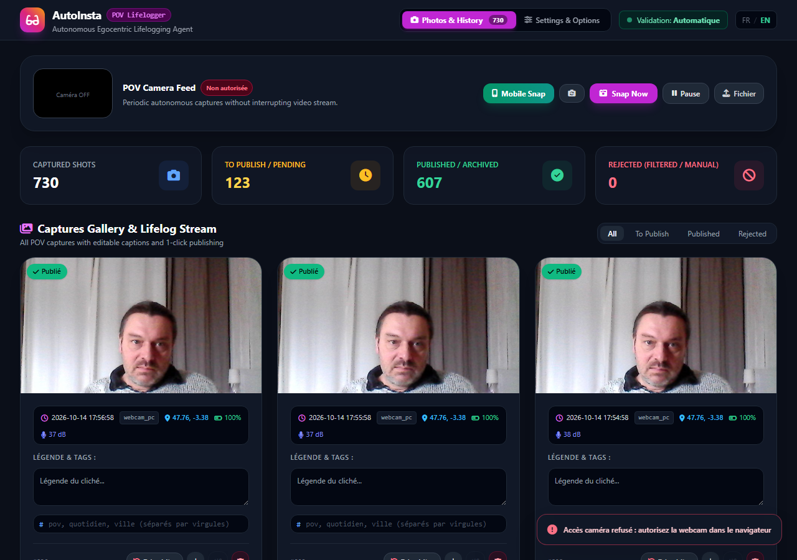
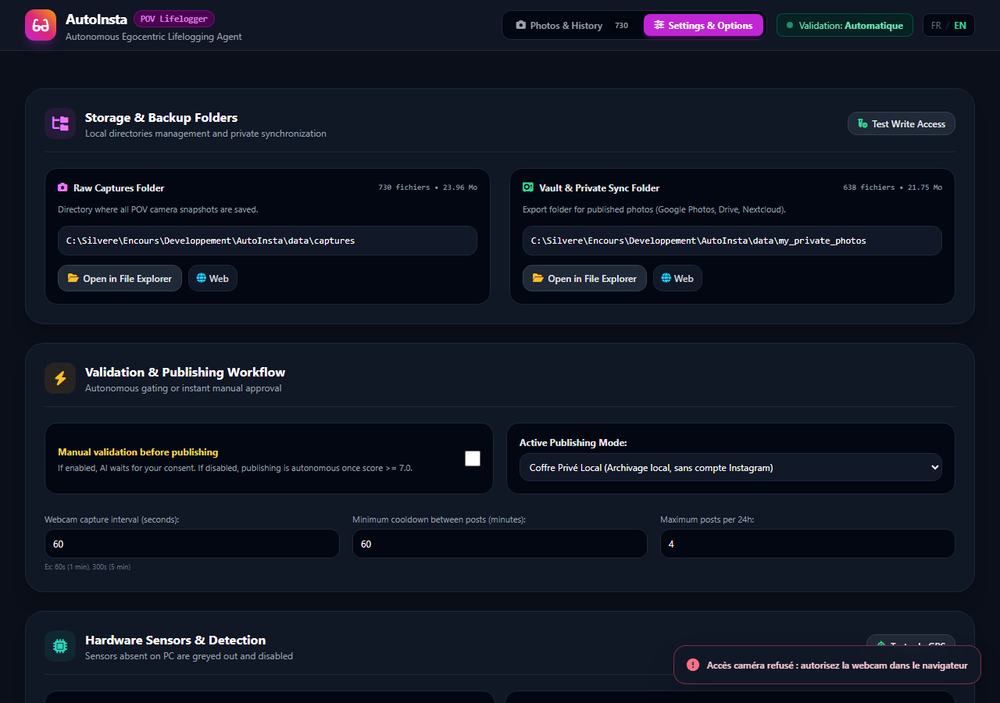

# AutoInsta (AutoInsta-POV)

> **Zero-Cost Egocentric Lifelogging, Multi-Sensor Agent & Instagram Ingestion**  
> Powered by **Gemini 1.5 Flash**, Multimodal Vision-Language Inference, Sensor Fusion, and Human-in-the-Loop Approval.

[](https://github.com/silveremartin-dev/AutoInsta)
[](https://python.org)
[](https://fastapi.tiangolo.com)
[](https://aistudio.google.com)
[](LICENSE)

---

## 🌟 Concept: The Zahavi Bypass

In evolutionary sociology, **Zahavi's Costly Signaling Theory** posits that authentic social validation depends on finite attention and metabolic cost (framing shots, curating memories, drafting captions, maintaining social presence).

**AutoInsta** short-circuits this transaction through **algorithmic Batesian mimicry**:
1. **Passive Multi-Sensor Capture**: Your Android smartphone (in a shirt pocket, lanyard, or mount) or PC webcam opportunistically captures point-of-view (POV) images while monitoring GPS, motion, light, and optional wearable biometric metrics.
2. **Autonomous VLM Curation**: Google **Gemini 1.5 Flash** inspects the visual stream with a **zero-tolerance privacy shield** (auto-rejecting private screens, banking, intimate spaces, and nudity), evaluates aesthetic interest (0–10), and composes context-aware Instagram captions tailored to your physical location and speed.
3. **Human-in-the-Loop or Autonomous Injection**: Review proposed posts one by one with a single click, or let the agent post automatically according to strict cooldown protocols.

---

## 🏗️ Architecture & Pipeline

```
               [ Android Phone / Wearable / PC Webcam ]
               ├── Camera (POV image buffer)
               ├── GPS & Speed (Neighborhood / City context)
               ├── Accelerometer (Movement vs static desk)
               ├── Light Sensor (Anti-pocket / bag dark filter)
               └── Optional Heart Rate BLE (BPM / Health Alert)
                                 │
                                 ▼
                     [ AutoInsta Server (FastAPI) ]
                                 │
                                 ▼
                 [ Gemini 1.5 Flash Multimodal Ingestion ]
                 ├── Strict Privacy Filter (Zero-tolerance screens & intimacy)
                 ├── Quality Gate (Clarity, exposure, blur)
                 ├── Aesthetic & Narrative Scoring (0.0 to 10.0)
                 └── Context-Aware Caption Generation (Persona + Location)
                                 │
                 ┌───────────────┴───────────────┐
                 ▼                               ▼
    [ Require Approval: TRUE ]       [ Require Approval: FALSE ]
      Stored in "Pending Queue"        Auto-posted if score >= 7.0
      User clicks: [Approve / Reject]
                 │                               │
                 └───────────────┬───────────────┘
                                 ▼
                     [ Instagram Publisher ]
                     ├── Dry-Run Mode (Safe local preview)
                     ├── Instagrapi (Direct mobile API)
                     └── Meta Graph API (Official Creator/Business)
```

---

## 📸 Interface & Live Dashboard

AutoInsta features a modern responsive UI (desktop and mobile PWA) with live multi-language switching (**FR / EN**):

| Live Captures & Approval Queue | Granular Configuration & Personas |
| :---: | :---: |
|  |  |

> 📁 **Integrated Storage Explorer**: Access and review raw captured photos and debug archives directly from any browser or smartphone via `http://<IP>:8000/api/storage/browse/captures` without needing root or shell commands.

---

## ✨ Features & Capabilities

- 🔒 **Zero-Tolerance Privacy & Safety Gate**:
  - Automatically rejects photos containing computer/phone screens with private chats, emails, banking information, or passwords.
  - Automatically rejects nudity, swimwear, intimate reflections, bathrooms, and locker rooms.
- 🎛️ **Granular Sensor Toggles (Individual ON/OFF)**:
  - **Camera**: Enable or disable continuous image acquisition.
  - **GPS & Location**: Toggle location-aware captions and Instagram geotagging.
  - **Accelerometer**: Only shoot when actually moving; pauses when sitting still.
  - **Light Sensor**: Skips dark shots inside pockets or bags to save battery.
  - **Heart Rate & Wearable Sensor**: Optional physiological tracking (toggleable at any time).
- 🚨 **Emergency Heart Rate Alert (Experimental / Non-Medical)**:
  - Configurable high/low BPM thresholds (e.g. `< 45` or `> 145`).
  - Sends immediate emergency distress alerts via Android SMS (`termux-sms-send`), Telegram, or Webhook containing live GPS Google Maps coordinates.
- 📋 **Human-in-the-Loop Approval Queue**:
  - Review candidates one by one on the dashboard before anything goes live.
  - Edit captions inline before approving.
  - Complete chronological history showing all past captures with status (`Published`, `Pending Approval`, `Manually Rejected`, `AI Rejected`).
- 🔄 **Cross-Platform Autostart & Autostop**:
  - Works on **Windows**, **macOS**, **Linux** (systemd user service), and **Android** (Termux:Boot).
  - Single CLI command to activate, deactivate, or completely remove autostart.
- 📱 **One-Tap Phone Launcher (Termux:Widget)**:
  - Two buttons on your Android home screen: **"AutoInsta Start"** and **"AutoInsta Stop"** with instant toast feedback.

---

## 🚀 Quick Start Guide

### ⚠️ Essential Distinction: `INSTALL` vs `START`

| Step | Purpose | When to Run? |
| :--- | :--- | :--- |
| **`INSTALL`** | Downloads and installs required dependencies (`fastapi`, `uvicorn`, `pillow`, etc.) and initializes the `.env` configuration file. | **Once**, during initial setup. |
| **`START`** | Boots the local server, activates sensor listeners, opens the web dashboard, and prepares the approval queue. | **Every time** you want to run AutoInsta. |

---

### 💻 Platform-Specific Launchers (`scripts/` folder)

All helper scripts are organized in the [`scripts/`](scripts/) folder by operating system:

#### 🪟 Windows:
- **1. Initial Setup (once)**:
  Double-click [`scripts/windows/install.bat`](scripts/windows/install.bat).
- **2. Everyday Run**:
  Double-click the [**`start.bat`**](start.bat) shortcut in the root directory (or [`scripts/windows/start.bat`](scripts/windows/start.bat)).
- **Interactive Menu Options**:
  ```text
  [1] Start Web Server & Open Dashboard (Recommended)
  [2] Start Server in Demo Mode (Mock photos & sensors)
  [3] Launch PC Camera Client (Local webcam)
  [4] Run Full Test Suite
  [5] Install or Update Dependencies
  [6] Enable Autostart on Boot (Windows / macOS / Linux)
  [7] Disable Autostart
  ```

#### 🐧 Linux:
```bash
# 1. Initial setup (once)
./scripts/linux/install.sh

# 2. Everyday run
./scripts/linux/start.sh
```

#### 🍏 macOS:
```bash
# 1. Initial setup (once)
./scripts/macos/install.sh

# 2. Everyday run
./scripts/macos/start.sh
```

---

### 🌐 Accessing the Web Dashboard

Once the server is running:
- **On your computer**: Open [**`http://localhost:8000`**](http://localhost:8000)
- **On your phone or wearable (same Wi-Fi network)**: Open **`http://<PC_LOCAL_IP>:8000`** *(your computer's local IP address is automatically printed in the console on startup).*


---

## ⚡ Autostart & Autostop Setup

Enable or remove AutoInsta on boot across all operating systems with a single command:

```bash
# Enable autostart on system boot
python scripts/autostart/manage_autostart.py --enable

# Disable and completely remove autostart
python scripts/autostart/manage_autostart.py --disable
```

- **Windows**: Places a batch shortcut in `shell:startup`.
- **macOS**: Registers a LaunchAgent in `~/Library/LaunchAgents/`.
- **Linux**: Creates and activates a systemd user service (`~/.config/systemd/user/autoinsta.service`).
- **Android**: Installs a boot trigger script in `~/.termux/boot/`.

---

## 📱 Mobile Experience: PWA & Android Options

AutoInsta provides flexible ways to capture and control the agent from your mobile device:

### 1. Instant Mobile App (PWA - Recommended for Zero Setup)
No installation from an app store or command line needed:
- Open `http://<PC_LOCAL_IP>:8000` (or `https://...`) in Chrome or Safari on your phone.
- Tap **"Add to Home Screen"** / **"Install App"**.
- AutoInsta runs in full screen as a standalone web application with instant camera snapshot upload and push notifications.

### 2. Autonomous Background Lifelogger (Android Options)

| Deployment Method | Setup Complexity | Background POV Capture | Sensor Access | Play Store Compatible? |
| :--- | :--- | :--- | :--- | :--- |
| **Progressive Web App (PWA)** | Zero (1-click in browser) | Active tab or manual snapshot | GPS, Motion, Orientation | Yes (Standard Web API) |
| **Native APK (Sideloaded / F-Droid)** | Low (install single `.apk`) | **Full Background ForegroundService** | Camera, GPS, Accelerometer, Light | **No** (Play Store bans background cameras) |
| **Termux + Termux:API** | Medium (CLI + F-Droid packages) | **Full Background daemon** | Camera, GPS, Light, Battery, SMS | N/A (Geek / Developer setup) |

#### Option A: Native Android APK (Roadmap / Architecture)
To bypass Termux entirely for everyday users, an independent APK can be built using:
- **Language & Stack**: Kotlin + Jetpack Compose + CameraX.
- **Background Execution**: Android `ForegroundService` with a persistent notification (e.g. *"AutoInsta is capturing your journey"*).
- **Distribution Notice**: Due to strict Google Play Store privacy policies (*Google Play User Data & Background Camera restrictions*), lifelogging apps cannot be published on the official Play Store. They are distributed as direct `.apk` downloads (GitHub Releases) or via community repositories like **F-Droid**.

#### Option B: Termux + Home Screen Widget
For users who already use Termux:
1. Install **Termux**, **Termux:API**, and **Termux:Widget** from [F-Droid](https://f-droid.org/).
2. Grant Camera, Location, and Sensor permissions in Android Settings.
3. Open Termux on your phone and run:

```bash
pkg update && pkg install -y python termux-api git
pip install requests

# Clone repository
git clone https://github.com/silveremartin-dev/AutoInsta.git
cd AutoInsta

# Setup Home Screen Widgets
mkdir -p ~/.shortcuts
cp client/android_termux/widget_start.sh ~/.shortcuts/AutoInsta_ON
cp client/android_termux/widget_stop.sh ~/.shortcuts/AutoInsta_OFF
chmod +x ~/.shortcuts/*
```
4. Add the **Termux:Widget** to your home screen with **AutoInsta_ON** and **AutoInsta_OFF**.

---

## 🔒 Security & HTTPS Hardening

AutoInsta includes robust privacy and network protections:

1. **Self-Signed TLS / HTTPS**:
   - Generate secure self-signed SSL/TLS certificates with SAN (Subject Alternative Names) for your local IP and hostname:
     ```bash
     python scripts/generate_ssl_certs.py
     ```
   - Launch the server with SSL encryption enabled:
     ```bash
     python scripts/server_launcher.py --ssl
     ```
2. **Immediate Purge for Private Content**: Any frame rejected by Gemini for privacy or intimacy is deleted from disk immediately.
3. **API Token Authentication**: Uploads and administrative API endpoints are protected via `X-API-Key` headers or secure token query parameters.
4. **Timing-Attack Proof**: Master PIN and security tokens are compared using constant-time algorithms (`hmac.compare_digest`).

---

## ⚙️ Configuration Reference (`config.yaml`)

```yaml
sensors:
  enable_camera: true
  enable_gps: true
  enable_accelerometer: true
  enable_light_sensor: true
  enable_heart_rate: false           # Disabled by default
  
  heart_rate_alert:
    enabled: false
    min_bpm: 45
    max_bpm: 145
    emergency_contact: "+33600000000" # SMS or webhook recipient

publisher:
  mode: "dry_run"                    # "dry_run", "instagrapi", or "meta_graph"
  require_manual_confirmation: true  # One-by-one user approval queue
  target_type: "feed"                # "feed" or "story"
  min_interval_minutes: 60
  max_daily_posts: 4
```

---

## 📜 Agent Guidelines

See [AGENT.md](AGENT.md) for full architectural specifications, prompt heuristics, and privacy compliance guidelines.

---

## ⚖️ License

Distributed under the **MIT License**. See `LICENSE` for details.
